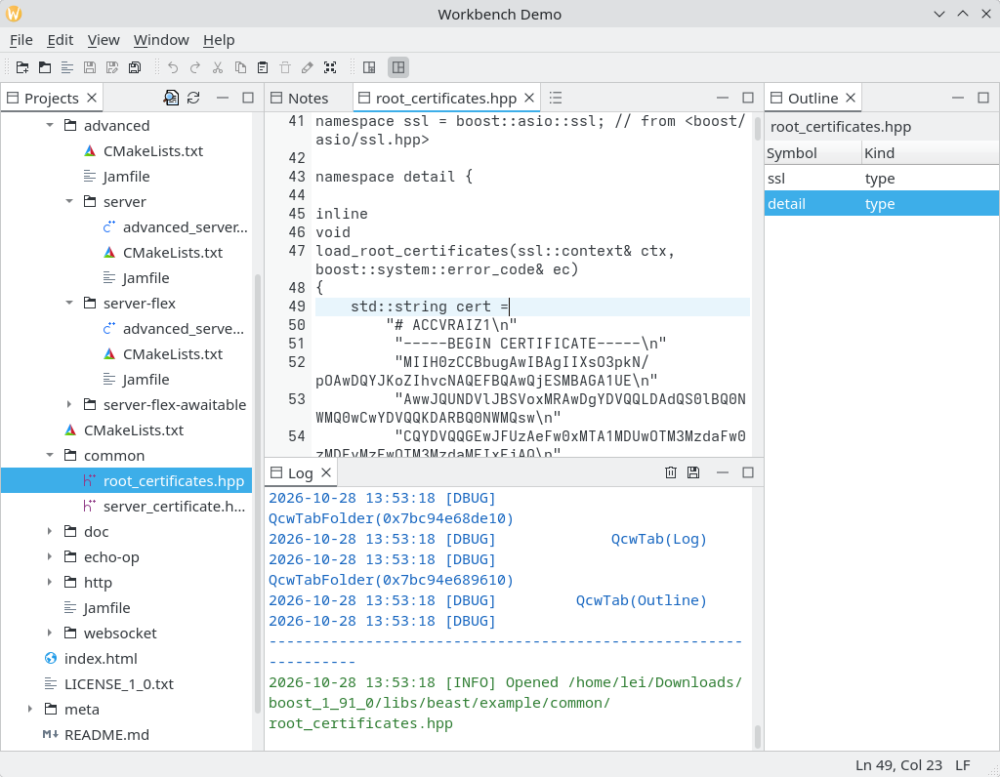
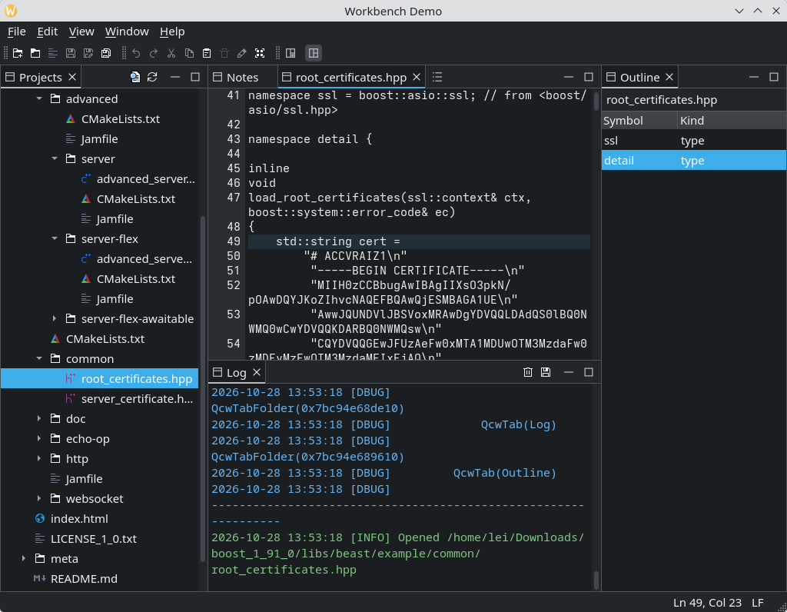
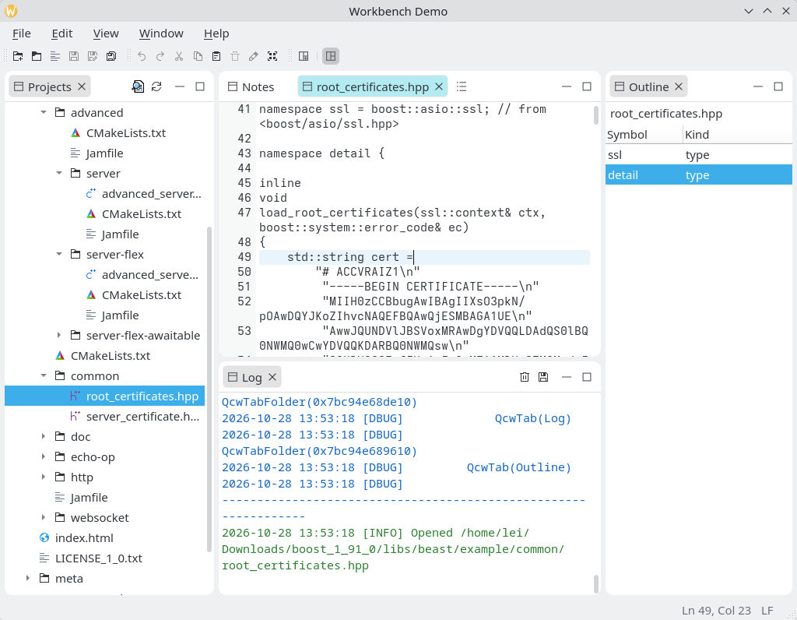
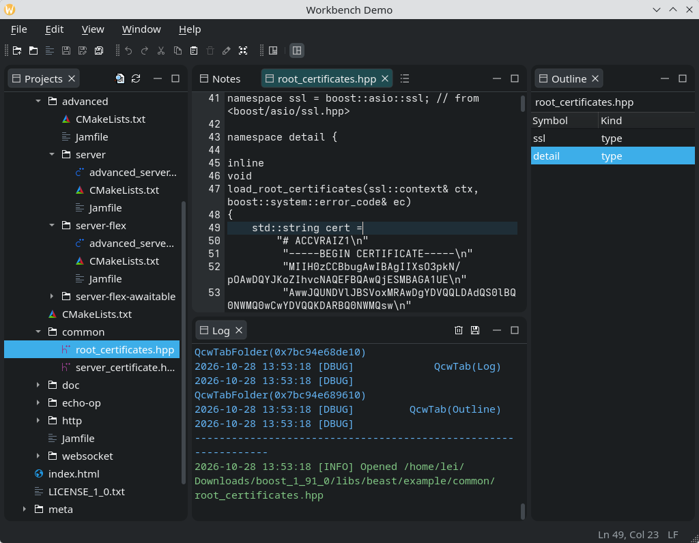

# QCW

QCW is a workbench framework for Qt 6 desktop applications — the layer between plain Qt
widgets and a finished IDE-style product. It supplies the shell an application of that shape
needs: a workbench that restores and saves sessions, windows that switch between perspectives,
tab folders that dock, float and minimize, and plugins that contribute views and layouts. An
application starts from a working shell and adds its own features as plugins.

- C++17, Qt 6.9+ (Widgets, Svg), CMake 3.23+
- Library target `qcommonworkbench`, version 2.0.0
- Docking widgets come from the companion **qcw-docking** library (`QCWDOCK::qcwdocking`), bundled as a git submodule
- BSD-3-Clause

## What you get

| Area | Provided by the framework |
|---|---|
| Workbench lifecycle | Session restore and save, multiple windows, plugin loading, global command handlers, and a shutdown that asks every view before closing |
| Perspectives | Named folder arrangements per window; the dummy perspective for views outside any perspective; a shared folder that survives perspective switches; save, reset and close commands; a saved-perspective store |
| Docking | The qcw-docking companion library: splitter tree of tab folders with drag-and-drop between them, detach-to-float, minimize to window-edge fast-view tool bars, maximize, placeholders, and XML layout state; usable on its own in a plain `QMainWindow` |
| Views | `QcwView` identity and re-creation through creators, per-view command handlers, status bar widget, top-right view tool bar, published topics, and an asynchronous close protocol for unsaved work |
| Menus and commands | A command catalog, declarative menu contributions with ordering and separators, handlers resolved per view, perspective, window or process, a searchable command palette, and action sets a perspective can hide as a group |
| Plugins | `QcwViewCreator` and `QcwPerspectiveCreator` interfaces, plus any `QcwPlugin` subclass for non-UI capabilities; a metadata macro pair, a loader and a manager; plugins never link to one another |
| Persistence | Window state files, per-view `extraState`, saved perspectives, and a `QSettings` provider owned by the workbench |
| Theming | Palette themes, application CSS, per-widget theme files, window styles (Framed, Cards), theme icons; Light and Dark themes ship with the library |
| Preferences | A page registry, a preferences dialog, and built-in Appearance (theme, language, font) and Notifications pages |
| Notifications | Stacked notification cards with levels, actions, timeouts and link handling |
| Interaction | Process-wide services plus window- and application-scoped topics with cached state and synchronous delivery |
| Utilities | Logger with file and sinks, splitter, filterable list, tree proxy model, fixed-row-height delegate |

## Concepts

```
QcwWorkbench                      one per process; restores the session, loads plugins
└── QcwWindow                     one or more; File/Edit/Window/Help, perspective bar
    ├── QcwPerspective "Project"  a named layout; only one is shown at a time
    │   ├── QcwTabFolderContainer the splitter tree of the perspective
    │   │   ├── QcwTabFolder      a tab folder; central, docked, floating or minimized
    │   │   │   └── QcwView       the content of one tab
    │   │   └── ...
    │   └── QcwFastViewToolBar    what a minimized folder becomes
    └── QcwPerspective ...
```

- **`QcwWorkbench`** owns the session and the windows. `initialize()` applies the process-wide
  setup (settings, logging, themes, plugins); `start()` restores the session and creates the
  windows. Exit and `QCoreApplication::quit()` go through the same close protocol as the
  window's close button.
- **`QcwWindow`** owns the central folder area, the perspective tool bar, the standard menus
  and the state file. Subclass it to choose the shared folder, catalogue your own commands and
  build a first layout.
- **`QcwPerspective`** is one arrangement of folders, built either by a creator plugin or from
  saved state. The window always has a *dummy* perspective for views that belong to no real
  one, and it never closes.
- **`QcwTabFolder`** and **`QcwTabFolderContainer`** are the docking machinery: folders split
  relative to one another, tabs move between folders or detach into floating windows, folders
  minimize to the window edge and restore.
- **`QcwView`** is what fills a tab. It reports its identity, its command handlers, its status
  bar widget and the topics it publishes, and it is asked before it is closed.

Plugins are how features arrive. The framework defines two plugin kinds of its own: a view
creator builds a type of view, a perspective creator a type of layout, and both are looked up
by the `type()` string that saved state stores. Everything else is a plain `QcwPlugin` subclass
with its own `category()`, so a plugin can also carry a service, a background task or another
non-UI capability — and contribute it from `doRegisterContributions()` — without adding any
widget to the window. An application can also define a creator interface of its own for a
capability it wants plugins to provide; see
[A plugin kind of your own](#a-plugin-kind-of-your-own).

### Docking without the workbench

The folder widgets live in the companion **qcw-docking** project. It depends only on Qt
Widgets: no workbench, no perspectives, no views and no plugins. `QcwTabFolderContainer` and
`QcwTabFolder` are ordinary widgets, so the container can be the central widget of a plain
`QMainWindow`. Its own `folder_container_demo` and `folder_renderer_demo` show that setup,
including a container hosted by a plain `QDialog` and a folder whose renderer is swapped at run
time; both examples ship with that repository.

QCW bundles qcw-docking as the `third_party/qcw-docking` submodule and re-exports it, so a
workbench application includes the docking headers from the same build. The docking catalogs
are registered by `QcwWorkbench::initialize()`, and the docking headers install under
`include/qcwdocking` rather than into QCW's own `include/qcw`.

## Build and run

Requirements: a C++17 compiler, CMake 3.23+, and the Qt 6.9+ Widgets and Svg development packages.
Clone with the submodule, or fetch it afterwards:

```sh
git clone --recursive <qcw-url>
# or, in an existing checkout:
git submodule update --init --recursive
```

```sh
cmake -S . -B build
cmake --build build -j"$(nproc)"
```

The build produces the library, `workbench_demo` and the tests under `build/bin`, and builds the
bundled qcwdocking library from the submodule. The demo target stages the themes and both
translation catalogs beside the executable, so a build-tree run finds them without extra
copies.

```sh
./build/bin/workbench_demo
```

`workbench_demo` is the application example: open a file in the project tree to get an editor in
the shared folder and its symbols in the outline, switch perspectives from
`Window > Perspective`, then close and restart — the layout, the open editors and the per-view
state come back. The docking-only demos live in the qcw-docking repository.

To link against an installed qcwdocking instead of the submodule, configure with
`-DQCW_USE_SYSTEM_QCWDOCKING=ON` and make the package discoverable through
`CMAKE_PREFIX_PATH`.

The test suite and the API documentation are not part of that default build; enable them with
`-DQCW_BUILD_TESTS=ON` and `-DQCW_BUILD_DOCS=ON` as described below.

## Tests

Tests are off by default — building them takes far longer than the library and the demos, and
most consumers of the library never run them. Turn them on at configure time:

```sh
cmake -S . -B build -DQCW_BUILD_TESTS=ON
cmake --build build -j"$(nproc)"
ctest --test-dir build --output-on-failure
```

CTest runs every test with `QT_QPA_PLATFORM=offscreen`. A test binary started by hand needs the
same variable, plus `QCW_TEST_AUTOCLOSE=1` so the demo windows close themselves:

```sh
QT_QPA_PLATFORM=offscreen QCW_TEST_AUTOCLOSE=1 ./build/bin/view_close_protocol_test
```

Turning the option off again in an existing build directory (`-DQCW_BUILD_TESTS=OFF`) stops
building the tests but leaves their old binaries in `build/bin`.

## Versioning and releases

QCW follows semantic versioning. `CMakeLists.txt` holds the single version number, and a release
tag is that number prefixed with `v`:

```cmake
# Single source of truth for the library version; release tags are v${PROJECT_VERSION}.
project(qcw
    VERSION 2.0.0
    LANGUAGES CXX
)
```

The version describes the public API: the classes and functions exported with `QCW_EXPORT`, the
installed headers, and the plugin interfaces (`QcwViewCreator`, `QcwPerspectiveCreator`). The
three digits move like this:

| Change | Version |
|---|---|
| A fix — a crash, a wrong result or a demo-only correction that leaves the public headers alone | patch, `2.0.x` |
| An addition — a new class, method, signal, command or topic, or a deprecation that keeps the old API working; existing applications and compiled plugins keep working | minor, `2.x.0` |
| A break — removing or renaming public API, changing a signature, behaviour or ownership contract, raising the minimum Qt version, or changing a plugin interface's vtable or IID | major, `x.0.0` |

The docking widgets version independently, as **qcw-docking** 1.x. QCW 2.x requires a
qcwdocking 1.x release; the installed `qcwConfig.cmake` asks for one through
`find_dependency(qcwdocking 1.0 REQUIRED)`. A docking change that removes or changes its public
API is a docking major release, and QCW then moves to a new major as well.

Adding a virtual method to a plugin interface counts as a break even though it adds rather than
removes: every plugin is a separate shared library, and an existing one does not implement the
new method, so all of them must be rebuilt. The same goes for restoring `Q_OBJECT` on an
interface, which changes its ABI. While the plugin interfaces are still settling, treat any
change that alters what a plugin must implement as major.

To cut a release:

1. Bump `VERSION` in `CMakeLists.txt`. The number also names the Qt help file
   (`build/docs/doc/qch/QCW-<version>.qch`).
2. Build with the tests enabled and run the suite; repeat with the ASAN configuration if you
   keep one:
   ```sh
   cmake -S . -B build -DQCW_BUILD_TESTS=ON
   cmake --build build -j"$(nproc)"
   ctest --test-dir build --output-on-failure
   ```
3. Commit the bump, then tag that commit and push both:
   ```sh
   git tag -a v1.1.0 -m "Qcw 1.1.0"
   git push origin master v1.1.0
   ```
4. Never move or reuse a published tag. A release with a defect is superseded by the next patch
   release, not repaired in place.

## API documentation

The headers are documented with Javadoc-style Doxygen comments, and `README.md` is the entry
page of the generated manual. The docs target is opt-in and needs Doxygen in addition to the
build requirements:

```sh
cmake -S . -B build -DQCW_BUILD_DOCS=ON
cmake --build build --target docs
```

The output lands in the build tree:

- `build/docs/doc/html/index.html` — the README as the main page, with every class, struct and
  file under it. Open it in a browser.
- `build/docs/doc/qch/QCW-<version>.qch` — the same content as a Qt help file for Qt Assistant
  (`assistant -collectionFile build/docs/doc/qch/QCW-<version>.qch`) or Qt Creator's Help mode
  (*Preferences > Help > Documentation > Add*). `qhelpgenerator` builds it in the same pass; when
  the tool is missing, the docs target still writes the HTML and says so at configure time.

Doxygen warnings go to `build/docs/doxygen-warnings.log`. Two kinds are expected there and do
not stop the build: members of the demo applications without comments, and the README's
in-page anchor `#a-plugin-kind-of-your-own`, which Doxygen cannot resolve because it numbers
Markdown headings itself.

## Start your own application

Subclass `QcwWorkbench` to say which window class to create, then run the standard
initialize/start sequence:

```cpp
#include "QcwWorkbench.h"
#include "QcwWindow.h"

#include <QApplication>

class Workbench : public QcwWorkbench
{
public:
    QcwWindow* createWindow() override { return new QcwWindow; }
};

int main(int argc, char* argv[])
{
    QApplication app(argc, argv);

    Workbench workbench;
    if (!workbench.initialize("myapp", "My App", "example.org", "Example", "1.0.0"))
    {
        return 1;
    }
    if (!workbench.start())
    {
        return 1;
    }

    return app.exec();
}
```

That window already has the File/Edit/Window/Help menus, a perspective tool bar, a dummy
perspective and a state file that it saves on close and restores on the next start.
Plugins placed in `plugins/` beside the executable are loaded by `initialize()`; pass
`loadPlugins = false` and call `QcwPluginLoader::loadPlugins()` from `preStart()` to load them
from somewhere else, as `workbench_demo` does.

There is no installed CMake package config yet; add the repository to your build and link the
library:

```cmake
add_subdirectory(path/to/qcw)
target_link_libraries(myapp PRIVATE qcommonworkbench Qt::Widgets)
```

To customize the window, subclass `QcwWindow` and override:

- `createSharedFolder()` — the folder every perspective shows and keeps across switches, for
  editors that must survive a perspective change;
- `postSetupUi()` — runs after both a fresh setup and a restored state; check
  `isRestoredFromState()` before building a default layout.

Catalogue the commands your application adds and place them with contributions — that is what
both the menus and the command palette read; see *Menus, commands and tool bars* below.

See [`examples/workbench_demo/MainWindow.cpp`](examples/workbench_demo/MainWindow.cpp) for the
full example, including the demo's own View menu, its contributions into File and the file and
edit tool bars that share the window's command actions.

## Plugins: views and perspectives

A view plugin pairs a `QcwView` subclass with a `QcwViewCreator`. The creator is the object the
framework knows: it builds views, reports what its tabs are called, and is the natural place for
preferences pages and services. The two creator interfaces are only the framework's own plugin
kinds, not the limit of what a plugin may be: subclassing `QcwPlugin` directly and choosing a
`category()` packages any other capability the same way, UI or not. In `workbench_demo` the
editor creator is also the `IEditorService` provider and owns a preferences page, and the log
view is a logger sink — contributions that go well beyond the widgets that arrived with them.

```cpp
// MyViewCreator.h
#pragma once

#include "QcwPluginTemplate.h"
#include "QcwViewCreator.h"

class MyViewCreator : public QcwViewCreator
{
    Q_OBJECT
    Q_PLUGIN_METADATA(IID "org.qcw.QcwViewCreator" FILE "myview.json")
    Q_INTERFACES(QcwViewCreator)
    QCW_PLUGIN_INTERFACE

public:
    QString defaultWindowTitle() const override;
    QIcon defaultViewIcon() const override;

private:
    QcwView* doCreate(QWidget* parent, const QList<QVariant>& args) override;
};
```

```cpp
// MyViewCreator.cpp
#include "MyViewCreator.h"
#include "MyView.h"
#include "PluginInfo.h"
#include "QcwThemeIcons.h"

QString MyViewCreator::defaultWindowTitle() const
{
    return tr("My View");
}

QIcon MyViewCreator::defaultViewIcon() const
{
    return qcw::themeIcon(qcw::Icon::View);
}

QcwView* MyViewCreator::doCreate(QWidget* parent, const QList<QVariant>&)
{
    return new MyView { parent };
}

QCW_PLUGIN_IMPLEMENT(MyViewCreator, "MyView")
```

`PluginInfo.h` defines the five metadata literals `QCW_PLUGIN_IMPLEMENT` writes into the object:

```cpp
#define QCW_PLUGIN_VERSION "1.0.0"
#define QCW_PLUGIN_PROVIDER "Example"
#define QCW_PLUGIN_UPDATE_TIME "2026-10-28 12:00:00 CST"
#define QCW_PLUGIN_DESCRIPTION "A sample view"
#define QCW_PLUGIN_DETAILS "Demonstrates a QcwView and its creator."
```

`myview.json` may be an empty object (`{}`). Build the plugin and place it beside the
executable; the demo's `qcw_demo_add_plugin()` helper in
[`examples/workbench_demo/plugins/CMakeLists.txt`](examples/workbench_demo/plugins/CMakeLists.txt)
shows the `qt_add_plugin` call and the `POST_BUILD` copy step:

```cmake
qt_add_plugin(myview_plugin
    MyView.cpp MyView.h
    MyViewCreator.cpp MyViewCreator.h
    PluginInfo.h myview.json
)
target_link_libraries(myview_plugin PRIVATE qcommonworkbench Qt::Widgets)
```

A perspective plugin has the same shape around `QcwPerspectiveCreator` and `QcwPerspective`.
`doCreate()` returns the perspective parented to the window; `createInitialLayout()` builds the
folder tree:

```cpp
void ProjectPerspective::createInitialLayout()
{
    auto* container = folderContainer();
    auto* central = window()->sharedFolder();
    if (central)
    {
        container->addSharedFolder(central, nullptr, qcw::RightDockArea);
    }
    else
    {
        central = container->createFolder(nullptr, qcw::LeftDockArea);
    }
    container->setCentralFolder(central);

    auto* tools = container->createFolder(central, qcw::LeftDockArea);
    container->setEmptyFolderAction(tools, qcw::EmptyFolderAction::Keep);

    const auto [view, icon] = getOrCreateView(QStringLiteral("ProjectView"));
    if (view)
    {
        tools->addTab(view, view->windowTitle(), icon);
    }
}
```

`getOrCreateView()` asks the window for an existing view of that type before creating one, which
is how a per-window singleton view is shared between perspectives. The complete examples are
[`TextEditorCreator.cpp`](examples/workbench_demo/plugins/texteditor/TextEditorCreator.cpp) and
[`ProjectPerspective.cpp`](examples/workbench_demo/plugins/projectperspective/ProjectPerspective.cpp).

Two rules matter more than the boilerplate:

- **`type()` is persisted.** Saved sessions refer to a view or perspective by this string.
  Renaming it strands everything saved under the old name.
- **The creator interface classes carry no `Q_OBJECT` on purpose.** `Q_DECLARE_INTERFACE`
  supplies the `qobject_cast` specialization that matches on the IID. Your plugin class needs
  `Q_OBJECT` plus `Q_INTERFACES()`, which is what puts the IID into its `qt_metacast()`.

A plugin with nothing to show in a tab skips the creators and subclasses `QcwPlugin` itself: set
`Q_PLUGIN_METADATA(IID "org.qcw.QcwPlugin" …)`, pick a `category()` of your own, and register what
it contributes in `doRegisterContributions()` — a service in `QcwServiceRegistry`, catalog entries
and contributions in `QcwCommandRegistry` and `QcwContributionRegistry`, a page in
`QcwPreferencesManager`. That is all `examples/workbench_demo/plugins/notes/NotesPlugin.cpp` does;
the pane that displays its notes is a separate, ordinary view plugin.

### A plugin kind of your own

The same pairing works for any capability an application wants to extend by plugin, not only
views and perspectives. The application's shared code declares two things: the interface an
implementation provides, and a creator — a `QcwPlugin` subclass — through which the host asks
for one and that also supplies the plugin metadata. Take a client that supports several AI
models:

```cpp
// AIModelConnector.h — what an implementation provides
#include <QString>

class AIModelConnector
{
public:
    virtual ~AIModelConnector() = default;
    virtual bool connect(const QString& remoteServer, const QString& apiKey) = 0;
    virtual bool sendMessage(const QString& message) = 0;
};
```

```cpp
// AIModelConnectorCreator.h — what a plugin implements
#include "AIModelConnector.h"
#include "QcwPlugin.h"
#include "QcwPluginTemplate.h"

class AIModelConnectorCreator : public QcwPlugin
{
public:
    static constexpr QLatin1String Category { "AIModelConnector" };

    /// The category this creator's plugins belong to.
    QString category() const override
    {
        return Category;
    }

    /// Builds the connector this plugin offers.
    virtual AIModelConnector* createConnector() = 0;
};

#define AIModelConnectorCreator_iid "com.thecom.AIModelConnectorCreator"
Q_DECLARE_INTERFACE(AIModelConnectorCreator, AIModelConnectorCreator_iid)
```

Like `QcwViewCreator`, the creator declares no `Q_OBJECT`: `Q_DECLARE_INTERFACE` supplies the
`qobject_cast` specialization, and each concrete plugin adds `Q_OBJECT`. A connector is not a
`QObject`, so the object a plugin .so hands to the workbench is the creator, and the connector it
builds is owned by whoever asks for it.

Nothing here touches the UI. A connector sends user prompts, receives the model's replies and
post-processes them in its own thread or in a thread pool, and the GUI thread comes in only when
the finished data has to reach the subscribers — queue the publication onto the GUI thread with
`QMetaObject::invokeMethod()` and publish it through `QcwTopicService::forApplication()`, so no
window is involved at any earlier point. This is what a plugin for any purpose looks like: the
framework supplies the loading, the metadata and the messaging, and knows nothing about what the
plugin does with them.

Then each model arrives as a plugin: `DeepSeekConnectorCreator`, `QWenConnectorCreator`,
`ChatGPTConnectorCreator`, and so on, each with `Q_PLUGIN_METADATA(IID
"com.thecom.AIModelConnectorCreator" …)`, `Q_INTERFACES(AIModelConnectorCreator)` and
`QCW_PLUGIN_IMPLEMENT(CreatorType, "DeepSeekConnector")`.

The host reaches them the way `QcwWindow` reaches view creators:

```cpp
for (auto* plugin : pluginManager->getPluginsByCategory(AIModelConnectorCreator::Category))
{
    if (auto* creator = qobject_cast<AIModelConnectorCreator*>(plugin))
    {
        models.append({ creator->type(), creator->createConnector() });
    }
}
```

A connector that is shared process-wide rather than built per consumer is a service instead: let
the creator itself implement `AIModelConnector`, `Q_INTERFACES(AIModelConnectorCreator AIModelConnector)`
and register it from `doRegisterContributions()`. That is the route `TextEditorCreator` takes with
`demo::IEditorService`, and it lets other plugins consume the connector without a window.

## Menus, commands and tool bars

Four things go into a menu entry, and the library keeps them apart:

| Piece | What it answers | Where it is registered |
|---|---|---|
| `QcwCommandInfo` | What the command is: label, category, description, shortcut, icon | `commandRegistry` |
| `QcwContribution` | Where it appears: which menu, which group, before or after what | `contributionRegistry` |
| `QcwCommandHandler` | What running it does, and whether it can right now | a view, a perspective, a window or the workbench |
| `QcwActionSet` | Which perspective switch hides a whole group of entries | `actionSetRegistry`, listed per perspective by `QcwPerspective::setVisibleActionSetIds()` |

A view no longer hands `QAction`s to the main menus; it answers commands:

```cpp
QHash<QString, QcwCommandHandler*> MyView::commandHandlers() const
{
    return {
        { QString(QcwWindowActionIds::ActionCopy), mCopyHandler },
        { QString(QcwWindowActionIds::ActionPaste), mPasteHandler }
    };
}
```

`QcwWindow::resolveHandler()` asks the current view first, then the current perspective, then the
window itself, then `QcwWorkbench::globalHandler()` — the first handler found wins. So `Edit/Copy`
copies text in an editor and a file path in the project tree, and only the view on screen decides
which one runs. The window re-reads `commandHandlers()` whenever the current view changes and
refreshes every command action it has built.

A menu entry *is* the command's `QAction`, which the window creates on demand in
`commandAction()`. It mirrors the catalogued info for text, icon, shortcut and checkable state, and
the resolved handler for enabled, visible and checked state. A command no scope handles is
disabled and hidden — and since Qt disables an invisible `QAction` too, its shortcut goes quiet
with it. The entry reappears on its own the moment a view that handles it becomes current, so
nothing has to rebuild the menu.

The window builds File, Edit, Window and Help and their Appearance, New View and Perspective
submenus from the contributions registered for them, and puts a separator wherever `groupId`
changes. Your own menus are ordinary `QMenu`s you put in `registeredMenus()`; contributions fill
those exactly the same way:

```cpp
QcwCommandInfo info;
info.id = QStringLiteral("myapp/Project/Open");
info.category = QString(QcwWindowActionIds::MenuFile);
info.label = tr("Open Project...");
info.defaultShortcut = QKeySequence::Open;
commandRegistry->registerCommand(info);

QcwContribution contribution;
contribution.id = QStringLiteral("myapp/file/openProject");
contribution.target = QString(QcwWindowActionIds::MenuFile);
contribution.commandId = info.id;
contribution.groupId = QStringLiteral("file-project");
contribution.before = QString(QcwWindowActionIds::ActionSave);
contributionRegistry->registerContribution(contribution);
```

`before` and `after` name either a contribution id or a command id inside the same target — the
sorter matches contribution ids first — and `before = "@start"` pins an entry to the top. A
contribution whose command the catalog does not list is left out. Contributions of the same
`actionSetId` appear and disappear together with the perspective that lists them.

Tool bars take the same commands rather than their own copies: `MainWindow::populateToolBar()` in
the demo asks `commandAction(id)` for each id and adds what it returns, so a tool bar button and
the matching menu item can never disagree about label, icon or enabled state.

Everything the catalog lists reaches the command palette — **Ctrl+Shift+P** or **Window > Command
Palette…** — grouped by category and searchable over label, description and shortcut, whether or
not a menu places it. A command with no handler is listed greyed out and cannot be selected, which
is how a user finds a command whose view is not open.

### Command and contribution id naming

Every id — command, contribution, action set, menu target — uses only `A-Z a-z 0-9 . / _ -`.
`/` marks hierarchy, `.` separates words inside a segment, and spaces, colons and backslashes are
not allowed. Each registry checks this when you register and rejects a malformed id with a
`qWarning`.

| Kind | Format | Example |
|---|---|---|
| Command id | `<namespace>/<Domain>/<Name>` | `File/Save`, `myplugin/Project/Open` |
| Contribution id | `<namespace>/<target-path>/<name>`, lowercase | `file.save`, `myplugin/project/open` |
| Action set id | `<namespace>/<set-name>`, lowercase | `debug`, `myplugin/project` |
| Menu target | `<MenuPath>`, PascalCase; equals the menu's id in `registeredMenus()` | `File`, `Window/Perspective` |
| Toolbar target | `ToolBar/<Name>` | `ToolBar/Main` |

Built-in ids carry **no** namespace prefix and live in `QcwWindowActionIds`; application and plugin
ids **must** carry their own prefix. Keep an application's ids in one header of its own — the demo
uses `plugins/common/DemoServices.h` — and a plugin's inside the plugin. An id is a contract only
with its own owner, so a plugin never publishes ids for someone else to name in a `before`;
cross-plugin contracts come from interfaces, not from ids.

## Unsaved work: the close protocol

A view with unsaved state overrides `canClose()` instead of intercepting close events. The
framework asks one view at a time, and the answer may arrive asynchronously:

```cpp
void MyView::canClose(const std::function<void(bool)>& answer)
{
    if (!mEditor->document()->isModified())
    {
        return answer(true); // synchronous answers keep the close immediate
    }

    const auto button = QMessageBox::warning(
        this, tr("Unsaved Changes"), tr("Save changes before closing?"),
        QMessageBox::Save | QMessageBox::Discard | QMessageBox::Cancel);

    if (button == QMessageBox::Cancel)
    {
        return answer(false);
    }
    answer(button == QMessageBox::Save ? save() : true);
}
```

The protocol covers the tab close button and context menu, perspective and window closes, the
floating folder's close button, Remove Window, and every `quit()` of the workbench application.
A refusal keeps every window open and cancels the quit. `QCoreApplication::exit()` bypasses the
question, and `QcwWindow::forceClose()` exists for shutdown paths that must not ask.

## Session state

`QcwWorkbench` writes the session and `QcwWindow` writes its own state file; a window restored
from that file gets its perspectives, folders, tabs and geometry back. Views persist their own
detail through the two `QcwPersistable` hooks, which end up in the tab's `extraState`:

```cpp
void MyView::saveExtraState(QVariantMap& state) const
{
    state.insert(QStringLiteral("filePath"), mFilePath);
}

void MyView::restoreExtraState(const QVariantMap& state)
{
    openFile(state.value(QStringLiteral("filePath")).toString());
}
```

The view is rebuilt through its creator with the saved creating arguments before
`restoreExtraState()` runs, so the creator's `type()` and the arguments are the only things a
restore depends on. `QcwSavedPerspectives` stores named layouts that can be opened in any window;
the demo saves one from `Window > Perspective > Save Perspective As`.

### Several windows at once

**New Window.** `Window > New Window` builds another window from the same `createWindow()` and
tracks it beside the first ones. From then on the workbench remembers it: every tracked window is
listed in the session, and the next start opens each one again from its own state file — one XML
per window id under the configuration directory — so it comes back with the perspectives, folders,
tabs, geometry and view contents it had when it was last closed.

**Remove This Window.** Removing is deliberately not the same as closing. Closing a window only
takes it off screen: the window stays tracked and its state file is written, so the next start
brings it back. `Window > Remove This Window` says that this window should never come back. The
workbench first asks that window's views through the close protocol, so unsaved work can stop the
removal and what happens then is the user's choice; once the views have agreed, the window is
untracked, closed without saving, and its state file is deleted — the next start does not open it.

Each window stands on its own:

- **Its own perspectives, folders and views.** Both windows load the same plugins, but a view,
  a perspective and its layout belong to the window that made them — including the
  per-window singleton views, so each window has its own project tree and its own editors.
- **Its own command palette.** Commands resolve against the window that owns the palette, so the
  same `Ctrl+Shift+P` in two windows lists the same ids with each window's current view deciding
  what is enabled.
- **Its own close decision.** Removing or closing a window asks only that window's views, and the
  application ends when the last window is gone; `File > Exit` (and any other `quit()`) asks
  every window first and stays open if one refuses.

## Talking between plugins

Plugins are separate libraries and do not link to each other. The framework offers two channels,
in order of preference:

**Services — a verb.** Declare an interface with `Q_DECLARE_INTERFACE`, register the
implementation, look it up by type:

```cpp
// provider, typically in doRegisterContributions()
auto* service = new EditorService;
if (!serviceRegistry->registerService<demo::IEditorService>(service))
{
    delete service;
}

// consumer
if (auto* editor = serviceRegistry->service<demo::IEditorService>())
{
    editor->revealAt(filePath, position);
}
```

A successful registration transfers ownership to the registry: the service is detached from any
parent and lives until the process exits, so it must never be deleted; a refused one stays with
the caller, which releases it. The first registration for an interface wins. The demo's
`demo::IEditorService` lets the project view and the outline drive the editor without either
plugin including the other.

**Topics — state and facts.** A `QcwTopicService` is a namespaced publish-subscribe hub with a
`QVariantMap` payload and a cached last value per topic. There is one service per window
(`QcwWindow::topicService()`) and one for the application (`QcwWorkbench::topicService()`, also
reachable through `QcwTopicService::forApplication()`); the scopes are isolated, so a `win/...`
topic published in one window never reaches another. The naming convention records the intended
scope: `win/...` for window topics and `app/...` for application topics; `QcwTopicRegistry`
warns when a registered id uses neither.

```cpp
// publisher (a view): only the current view publishes its subject
if (auto* window = owningWindow(); window && window->currentView() == this)
{
    window->topicService()->publish(demo::TopicEditorSelection, {
        { demo::PathKey, mFilePath },
        { demo::PositionKey, cursor.position() },
        { demo::RevisionKey, documentRevision() }
    });
}

// subscriber (a view): the base class follows the window through attach, moves and teardown,
// so the view holds no window pointer and replays the current payload on every (re-)attach
subscribeWindowTopic(demo::TopicEditorSelection,
                     [this](const QVariantMap& payload)
{
    showSymbolAt(payload.value(demo::PathKey).toString(),
                 payload.value(demo::PositionKey).toInt());
});

// application scope (the notes store): announce a change, and read the store on the other side
QcwTopicService::forApplication()->publish(demo::TopicNotesChanged, {
    { demo::NoteCountKey, notes.size() }
});

QcwTopicService::forApplication()->subscribe(demo::TopicNotesChanged, this,
                                             [this](const QVariantMap&)
{
    reloadNotes();
});
```

`publish()` caches the payload and calls the subscribers synchronously, in subscription order.
`subscribe()` replays the cached payload at once, so a view opened after the publisher still sees
the current state; `current()` reads the same value without subscribing, and `clear()` drops it
when the subject goes away. A subscription is tied to its receiver and disappears when that
object is destroyed; call `unsubscribe()` to stop earlier. The current implementation caches
every topic, so an announcement-style topic — the editor's `win/editor/opened`, `closed`, `saved`
and `pathChanged` topics in the demo — also replays its last payload to a late subscriber.
Consumers should use announcements to refresh derived state, not to reconstruct it.
A view reaches a window topic through `QcwView::subscribeWindowTopic()` rather than through the
service itself: the base class subscribes and re-subscribes as the view attaches, moves between
windows and detaches, and stops delivering when its window is being destroyed, so no view has to
cache a `QcwWindow*` — a held window pointer reads a private that the window's destructor has
already freed by the time the folder teardown reaches the view.

Delivery is synchronous on the GUI thread. The service is not thread-safe; a worker thread that
has data to publish should queue the call with `QMetaObject::invokeMethod()`.

A view that publishes the current subject does so only while it is the window's `currentView()`,
and clears its topic when it stops being current — the window does neither on the view's behalf.
Topic ids and payload keys are the contract between publisher and subscriber: keep them in a
shared header, as the demo does in
[`DemoServices.h`](examples/workbench_demo/plugins/common/DemoServices.h) and
[`DemoNotes.h`](examples/workbench_demo/plugins/common/DemoNotes.h), and register them in
`QcwTopicRegistry` when tooling or other plugins should discover them — the demo registers every
one of its topics from the publisher's `doRegisterContributions()`, with description, payload
keys and statefulness. `QcwTopicService::forApplication()` returns the workbench's service: the
workbench attaches itself to the `QApplication` in `initialize()`, and only when no workbench
exists does the accessor fall back to a process-wide service for tests. The full design and
migration rationale are in
[`docs/qcw-topic-service-design.md`](docs/qcw-topic-service-design.md).

### Who owns what

Every registry and handler map in the framework follows one of three ownership models. Match the
model of the class you are extending.

- **Copies — owns nothing.** `QcwActionSetRegistry`, `QcwCommandRegistry`,
  `QcwContributionRegistry`, `QcwSavedPerspectives`, `QcwThemeManager` and `QcwTopicRegistry`
  store values — a
  struct, a string, a path or a `std::function`. The caller may drop the original as soon as the
  call returns, and removal, where the class offers it, only forgets the copy. Most removal
  methods in this group exist for tests that share the process-wide instance and for
  `QcwBuiltinCommands::unregisterCommands()`; production code registers once, because nothing
  unloads. `QcwThemeManager::removeTheme()` is the exception the domain needs: themes come and
  go through the theme dialog.
- **Borrowed — owned elsewhere.** `QcwPluginManager` (plugin objects), the handler maps of
  `QcwWindow`, `QcwPerspective` and `QcwWorkbench`, and `QcwLogger` sinks keep a raw pointer and
  never delete it. The provider keeps ownership and must outlive the registration. The handler
  maps drop an entry automatically when its handler is destroyed, and registering an id again
  leaves the previous handler untouched. A logger sink is not a QObject, so it must call
  `QcwLogger::removeSink()` before it is destroyed.
- **Owned forever.** `QcwServiceRegistry` and `QcwPreferencesManager` take ownership on a
  successful registration: the service is detached from any parent or the page is kept as it
  is, and neither is ever deleted — not even at shutdown. A refused registration returns false
  and leaves the object with the caller, which must delete it. There is no removal API.

The docking registries — `QcwTabPaneManager`, `QcwFloatingFolderMonitor`,
`QcwFastViewStyleSettings` and `QcwTabFolderRendererCreators` — moved to qcw-docking and follow
that repository's ownership rules; the pane manager is the one there that deletes what it
tracks. `QcwTopicService` is scope-owned: its lifetime belongs to the window or workbench that
created it, not to a registry.

## Preferences

A preferences page is a widget that owns one `QSettings` group. It reads and writes that group
through `settings()`, which returns the store of the widget showing the page (or the
process-wide store when there is no such widget). `loadSettings()` is called every time the page
is shown and must not write; `restoreDefaults()` backs the dialog button; changes apply as the
user edits, with no Apply/Cancel step.

```cpp
class MyPreferencesPage : public QcwPreferencesPage
{
    Q_OBJECT
public:
    QString settingsGroup() const override { return QStringLiteral("myplugin"); }
    QString name() const override { return tr("My Plugin"); }
    bool matchesFilter(const QString& filterText) const override;
    void restoreDefaults() override;
    void loadSettings() override;
};
```

A plugin registers its page from the contribution hook. A successful registration transfers
ownership to the registry: the page lives until the process exits and must never be deleted. A
refused page stays with the caller, which releases it:

```cpp
void MyViewCreator::doRegisterContributions()
{
    auto* page = new MyPreferencesPage;
    if (!preferencesManager->registerPage(page))
    {
        delete page;
    }
}
```

`QcwWorkbench` registers the built-in Appearance page (theme, UI language, UI font) and
Notifications page. A page reads and writes through `QcwPreferencesPage::settings()`, which
returns a fresh `QSettings` by value; without an installed provider it falls back to
`QcwSettings::get()`. `QcwWorkbench::initialize()` installs an INI provider under the
application's config directory unless the application installed one first. The demo's
`TextEditorAppearancePreferencesPage` and `LogViewAppearancePreferencesPage` show a page whose
edits are pushed into open views through `settingsChanged()`.

A page does not have to live in the global registry. `QcwPreferencesWidget` and
`QcwPreferencesDialog` take the page map and a `QcwSettingsProvider`, so one project can show
its own pages and edit its own INI file while the global dialog keeps using the process-wide
store:

```cpp
auto* page = new ProjectPreferencesPage;
QMap<QString, QcwPreferencesPage*> pages { { page->settingsGroup(), page } };
QcwSettingsProvider projectStore = [path = projectSettingsPath]()
{
    return QSettings(path, QSettings::IniFormat);
};

auto* dialog = new QcwPreferencesDialog(pages, projectStore);
// The dialog borrows the pages: delete `page` after the dialog is gone.
```

Pass an empty provider (`{}`) to keep the process-wide store. A page holds its provider for
life, so give each scope its own page instances instead of sharing one page between scopes.
The built-in Appearance page is deliberately process-wide and ignores a scoped provider,
because the theme, language and font it edits apply to the whole process.

## Language

The UI language is a setting on the built-in Appearance page, and `QcwTranslations` is the subsystem
that applies it. A language is a set of catalogs that load together: `qtbase_<locale>.qm` for Qt's
own strings, `qcw_<locale>.qm` for this library's and the demos', and `qcwdocking_<locale>.qm`
for the docking widgets. QCW ships no copy of Qt's
catalogs — it loads them from Qt's own translations directory, so they are always the ones belonging
to the Qt the application links against rather than a snapshot someone committed. A base is taken
from the first directory that has it, searched in this order: the installed `qcw/translations` data
directory, `translations` beside the executable, the directories an application registers, and
Qt's own. The repository ships `zh_CN` and `zh_TW`, each as a `.ts` source and a compiled `.qm`; the
`.ts` files are deployed with the `.qm` so a catalog can be edited and recompiled next to the
program.

`QcwWorkbench::initialize()` registers the `qcwdocking` base before it applies the stored
language, so the folder menus, tooltips and settings dialog follow the language selector like
QCW's own chrome. The qcwdocking catalogs install into the same `share/qcw/translations`
directory; a host that links the library through `find_package(qcwdocking)` only has to install
its translations next to QCW's.

**An application's own strings.** Register the base your catalogs use, and the directory holding
them if they do not live beside the executable:

```cpp
// Once during startup, before the language is applied — or from a plugin's
// doRegisterContributions(), which QcwWorkbench accounts for by applying again after the load:
QcwTranslations::registerCatalogBase(QStringLiteral("notesapp"));   // notesapp_zh_CN.qm
QcwTranslations::addCatalogDirectory(dataPath + QStringLiteral("/translations"));
```

The Appearance page then installs your catalogs the same way it installs QCW's, and its selector
offers every locale your bases cover. The listing comes from the application-owned bases and never
from `qtbase`: a Qt installation carries a catalog for every language Qt supports, and offering them
all would advertise a user interface that the strings cannot follow. `en` needs no catalog at all,
being the language the sources are written in, so it is offered on its own terms.

**Following the language from code** does not mean reading the stored setting, which belongs to this
subsystem. `QcwTranslations::currentLanguage()` answers the locale in effect, `storedLanguage()` the
choice behind it (empty means the system), and every switch is announced on the application-scope
`QcwLanguageTopic` (`app/language`):

```cpp
QcwTopicService::forApplication()->subscribe(QString(QcwLanguageTopic), this,
                                             [this](const QVariantMap& payload)
                                             { retranslateForLocale(payload); });
```

An application can switch the language itself with `QcwTranslations::setLanguage()`, which is exactly
what the Appearance page calls.

**What makes a string follow the language.** `tr()` resolves once, where it is called, and what it
hands back is a plain `QString`. A label built with `setText(tr("Save"))` therefore keeps the
language it was born in, and a widget follows the change only if it re-applies its own texts. Qt
delivers `QEvent::LanguageChange` to every widget of every top-level window — hidden ones included,
parent first — so a class needs nothing beyond a `changeEvent()` that calls its `retranslateUi()`.
Every piece of framework chrome does: the tab folder's menu, tooltips and settings dialog, the
preferences dialog and widget, the theme dialogs, the command palette, the notification card and the
filterable list. `QDialogButtonBox` re-texts its own standard buttons.

**What a widget cannot do for itself** is text the *window* derived from something else, and that is
what `QcwWindow::retranslateUi()` — the hook an application overrides — handles:

```cpp
void MainWindow::retranslateUi()
{
    QcwWindow::retranslateUi();   // view titles, perspective buttons, built-in menu titles, built-in command labels

    setWindowTitle(tr("Workbench Demo"));
    registerFileCommands();       // re-registering the catalog entries is what re-lists them in the palette
    rebuildToolBars();
}
```

`QcwView::defaultTitle()` is the baseline the window compares a tab's text against, and
`QcwViewCreator::create()` is what stamps it — so a view reaches the window through a perspective,
the New View menu or another plugin's own `addTab()` and is re-resolved the same way either time. A
tab that still wears its creator's `defaultWindowTitle()` — with or without the ` 1` ordinal that made
it unique — is re-resolved from the creator; anything else is a name the user typed and is left alone.
A perspective's `name()` is never rewritten, because it is the file name its saved layout is stored
under, so its button shows `displayName()` while `name()` stays the identity.

Saved state carries both halves: each tab stores its text and the `defaultText` it was derived
from, and each perspective stores its `name` beside the `autoName` that says whether that name came
from its creator. A session written in one language therefore opens in the language now installed,
and a tab saved under a rename comes back renamed. `saveState()` writes both even when they have
nothing to record, so a document can tell an untouched tab from one a caller named itself — and a
document older than the attributes cannot, which is read as "re-derive it": the first start after
upgrading brings an old session into the current language, and its next save records the baselines
that keep a later rename.

**Adding a language** is two commands and one file:

```
lupdate -recursive src examples -ts translations/qcw_fr_FR.ts
lrelease translations/qcw_fr_FR.ts
```

`lupdate` keys every message by the class that asked for it (`QcwTabFolder`, `NotesView`,
`demo::FontPreferenceRow`), and the new catalog needs no code change: the Appearance page lists any
locale that has a catalog under a base it owns. A message the catalog leaves unfinished falls back
to the source text, which is English, so `lrelease`'s report of finished messages is the thing to
watch.

## Theming and window styles

A theme is a directory; the two shipped themes are `themes/QcwLight` and `themes/QcwDark`.

| File | Purpose |
|---|---|
| `QcwPalette.theme` | Required JSON: widget style, palette colors, disabled colors |
| `main.css` | Optional application-wide stylesheet |
| `<Widget>.theme` | Optional data file for one widget type, loaded through `QcwWidgetTheme<T>` and reloaded on theme change |
| `QcwWindow.<style>.theme` | Optional window style: tab folder renderer, central margins and window CSS |

The window styles shipped with the themes are `Framed` (flush folders separated by lines) and
`Cards` (rounded panels separated by gaps). `QcwWindowStyler` applies the current one to every
window and to folders created later:

```cpp
windowStyler->setCurrentStyle(QStringLiteral("Cards"));
themeManager->changeTheme(QStringLiteral("QcwDark"));
```

`qcw::themeIcon(qcw::Icon::View)` returns an icon that follows the theme.

The four states below are `workbench_demo` with the same layout: the top row changes only the
theme, the bottom row only the window style.

| Light, `Framed` | Dark, `Framed` |
|---|---|
|  |  |
| **Light, `Cards`** | **Dark, `Cards`** |
|  |  |

Theme-aware widgets keep their colors in a `.theme` file, as `LogView` does in the demo;
`QcwWidgetTheme` hands the JSON to the widget and reloads it when the theme changes. Images in
theme files are referred to as `url(%{themeDirectory}/images/name.svg)`. The Appearance preferences page and `QcwThemeDialog`
expose the same operations to users.

## Notifications and logging

Notification cards are posted through the global manager:

```cpp
QcwNotification notification;
notification.level = QcwNotification::Level::Warning;
notification.title = tr("Connection lost");
notification.text = tr("Retrying in the background.");
notification.timeoutMs = 0; // stay until dismissed
notificationManager->post(notification);
```

`QcwLogger::install()` routes every `qDebug()`/`qWarning()`/`qCritical()` message to a file while
keeping the console output; `QcwWorkbench::initialize()` installs it. A view can subscribe to the
same lines by implementing `QcwLoggerSink` and calling `QcwLogger::addSink()` —
[`LogView`](examples/workbench_demo/plugins/logview/LogView.cpp) is the demo's log pane. A sink
runs on the thread that logged, so a sink that touches widgets must marshal the line itself.

## Utility widgets and services

- `QcwSplitter` — a `QSplitter` whose handle paints a visible sunken groove, used by the
  preferences widget.
- `QcwTreeProxyModel` — recursive filter proxy for a `QAbstractItemModel` tree.
- `QcwFixedRowHeightItemDelegate` — a constant row height regardless of font or icon.
- `QcwClickableLabel` — a `QLabel` that emits `clicked` and `doubleClicked` for left-button
  clicks, for captions that act as links.
- `QcwPreferencesDialog`, `QcwThemeDialog`, `QcwNotificationBox` — the standard dialogs and card.
- `QcwSavedPerspectives` — the saved layout store.

## The demos

| Demo | Read it for |
|---|---|
| [`workbench_demo`](examples/workbench_demo/README.md) | The whole framework assembled: workbench, window, perspectives, shared folder, plugin views, services, topics, preferences, logging and theming — including one plugin that adds no view at all |

The qcw-docking repository carries the two docking-only examples: `folder_container_demo` for
creating and arranging folders, the layout XML and a container hosted by a plain `QDialog`, and
`folder_renderer_demo` for replacing how tab folders are painted. Each demo has its own README
with the files to read and the gotchas that are not obvious from the API.

## Repository layout

```
src/core/           plugins, settings, logging, persistence
src/notifications/  notification manager and cards
src/preferences/    page contract, registry, dialog
src/theming/        theme manager, widget themes, theme utilities and icons
src/widgets/        reusable widgets and models
src/workbench/      workbench, window, perspective, view, creators, commands and their
                    handlers, contributions and action sets, service registry, topic service
                    and registry, window styler
third_party/qcw-docking/
                    the docking submodule: tab folders, containers, floating folders,
                    fast-view tool bars, renderers
themes/             QcwLight and QcwDark
translations/       the language catalogs this project owns: qcw_<locale>.ts and .qm
examples/           workbench_demo
tests/              behaviour tests, run through CTest
```

The public headers under `src/` are the API reference: every class carries a Doxygen class-level
comment that explains its contracts, ownership rules and the reasons behind them. Start with
`QcwWorkbench.h`, `QcwWindow.h`, `QcwView.h` and `QcwPerspective.h`.

## License

BSD-3-Clause. See [LICENSE](LICENSE). Sources carry SPDX headers; QCW's themes and catalogs
install under `share/qcw`, and the qcw-docking catalogs install alongside them.
